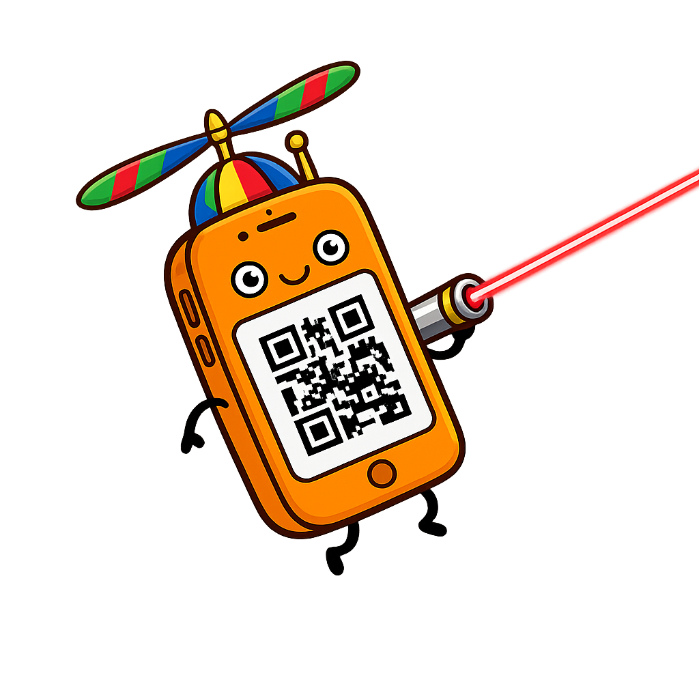

<br/>
<div align="center">
  <a href="" rel="noopener">
  </a>
</div>
<br/>
<div align="center">

# Gyroclopter

Point your phone, and then point your phone.

[](http://github.com/ryanraposo/LoveItShipIt)

</div>

## Quick Install

### Windows
Download the latest installer from [Releases](https://github.com/ryanraposo/gyroclopter/releases), run it, and launch Gyroclopter from the Start Menu.

### Linux
Download the latest `.deb` from [Releases](https://github.com/ryanraposo/gyroclopter/releases) and install:
```bash
sudo dpkg -i gyroclopter_*.deb
```

Then launch from your applications menu.

### macOS
A single universal `.pkg` installer is planned for the next public release. Open the package, follow Installer's prompts, and launch Gyroclopter from Applications. Intel and Apple silicon use the same file. For current unsigned development builds and Accessibility setup, see [macOS setup](MACOS.md).

---

## Platform Roadmap

TV targets are ordered by approximate global popularity, using [AdKemix's Q2 2025 active-device estimates](https://www.hbbtv.org/wp-content/uploads/2025/11/Damien-de-FOUCAULT-Adkemix_TV-OS-Panorama_Nov-2025_presentation_.pdf), [2026 US connected-TV usage](https://www.prnewswire.com/news-releases/parks-associates-roku-28-and-samsung-23-dominate-connected-tv-platforms-controlling-access-to-streaming-audiences-in-the-us-market-302749732.html) and [Whale TV's installed base](https://whaletv.com/news/whale-tv-expands-global-footprint-with-new-tv-brand-partnerships-in-europe-brazil-and-australia). The order is indicative where comparable global figures are unavailable; it is not implementation order. A checked box means verified support on physical hardware.

| Platform | Summary | Issue number | Checkbox |
| --- | --- | --- | :---: |
| Android TV / Google TV | Paired LAN remote; Bluetooth HID pointer. | [#27](https://github.com/ryanraposo/gyroclopter/issues/27) | ☐ |
| Samsung Tizen | Paired WebSocket navigation; HID feasibility. | [#28](https://github.com/ryanraposo/gyroclopter/issues/28) | ☐ |
| LG webOS | SSAP pointer, click, scroll and navigation. | [#31](https://github.com/ryanraposo/gyroclopter/issues/31) | ☐ |
| Roku OS | Authorized remote or hardware fallback; policy gate. | [#29](https://github.com/ryanraposo/gyroclopter/issues/29) | ☐ |
| Amazon Fire TV | Fire OS remote; separate Vega OS feasibility. | [#26](https://github.com/ryanraposo/gyroclopter/issues/26), [#42](https://github.com/ryanraposo/gyroclopter/issues/42) | ☐ |
| Whale OS / Foxxum | Authorized remote or HID feasibility. | [#49](https://github.com/ryanraposo/gyroclopter/issues/49) | ☐ |
| Hisense VIDAA | Partner or authorized LAN remote. | [#32](https://github.com/ryanraposo/gyroclopter/issues/32) | ☐ |
| Vizio SmartCast / CastOS | Paired HTTPS remote; firmware compatibility. | [#33](https://github.com/ryanraposo/gyroclopter/issues/33) | ☐ |
| Apple tvOS | Companion remote; system focus and media. | [#30](https://github.com/ryanraposo/gyroclopter/issues/30) | ☐ |
| Huawei HarmonyOS | Distributed remote and HID feasibility. | [#46](https://github.com/ryanraposo/gyroclopter/issues/46) | ☐ |
| Titan OS | Partner remote and HID feasibility. | [#43](https://github.com/ryanraposo/gyroclopter/issues/43) | ☐ |
| Xumo / Comcast / Sky | RDK / Firebolt control feasibility. | [#45](https://github.com/ryanraposo/gyroclopter/issues/45) | ☐ |
| TiVo OS | Authorized remote or hardware fallback. | [#44](https://github.com/ryanraposo/gyroclopter/issues/44) | ☐ |

Other platform work (not directly comparable to TV market share): [macOS #25](https://github.com/ryanraposo/gyroclopter/issues/25), [ChromeOS #34](https://github.com/ryanraposo/gyroclopter/issues/34), [native iOS / Android controller #48](https://github.com/ryanraposo/gyroclopter/issues/48), [external HID / HDMI-CEC bridge #47](https://github.com/ryanraposo/gyroclopter/issues/47).

Platform architecture: [adapter layout and integration rules](platforms/README.md) · [runtime contract](ARCHITECTURE.md).

Shared implementation foundation: [#41](https://github.com/ryanraposo/gyroclopter/issues/41).

---

## Development Setup

### 1. Clone and install
```bash
git clone https://github.com/ryanraposo/gyroclopter.git
cd gyroclopter
npm install
```

### 2. Linux: install mouse tools
**X11:**
```bash
sudo apt install xdotool
```

**Wayland:**
```bash
sudo apt install ydotool
```

### 3. Run
```bash
npm start
```

Scan the QR code with your phone, accept the certificate warning, grant motion permission, and calibrate.

---

## Build

```bash
# Build both Windows and Linux installers
npm run build

# Or build for specific platforms:
npm run build:win    # Windows installer (.exe)
npm run build:linux  # Linux package (.deb)
npm run build:mac    # Universal macOS installer (.pkg; on macOS)
```

**Requirements:**
- **macOS builds:** Xcode command-line tools and Node.js 24; public PKG distribution requires signing and notarization.
- **Linux builds:** No extra dependencies
- **Windows builds (from Linux):** Requires Wine (`sudo apt install wine64`)

Produces:
- `dist/Gyroclopter Setup *.exe` (Windows NSIS installer, ~75 MB)
- `dist/gyroclopter_*.deb` (Linux Debian package, ~71 MB)
- `dist/Gyroclopter-<version>.pkg` (universal macOS installer)

---

## Iconography

### Source File

All icons are generated from a single source file:

- **Source:** `build/icon-source.png` (512x512 px PNG recommended)

Update this file when changing app branding. It is the single source of truth for all icon assets.

### Generate Icon Assets

Before building, generate all icon formats:

```bash
npm run build:icons
```

This creates:

| Asset | Format | Usage |
|-------|--------|-------|
| `build/icon.ico` | Multi-size ICO | Windows app, installer, uninstaller |
| `build/icons/*.png` | PNG (16–256 px) | Linux `.deb` package |
| `build/resources/favicon.ico` | ICO | Electron window (16x16) |
| `app/favicon.ico` | ICO | Windows system tray |

### Final Build Artifacts

**Windows:**
- Installer: `dist/gyroclopter-*.exe` (uses `build/icon.ico`)
- App: Embedded icon in executable
- Tray: 16x16 favicon in system tray

**Linux:**
- Package: `dist/gyroclopter_*.deb` (uses `build/icons/` directory)
- System icons: Installed via Debian package manager

---

## Usage

1. Launch Gyroclopter
2. Click **Start Server**
3. Scan QR code or open URL on phone
4. Accept self-signed certificate warning
5. Tap **Allow & Connect** (grant motion permission)
6. Tap **Calibrate** while pointing at cursor
7. Tilt phone to move, use buttons for clicks/scroll

Window minimizes to tray; quit from tray to stop server.

---

## Mobile Controls

| Control            | Action                                     |
|--------------------|--------------------------------------------|
| Tilt phone         | Move cursor                                |
| Tap main pad       | Toggle motion on/off                       |
| Hold **LEFT**      | Left mouse button down/up                  |
| Tap **RIGHT**      | Right-click                                |
| Swipe **SCROLL**   | Scroll up/down                             |
| Sensitivity slider | Adjust speed (1–25)                        |

---

## Configuration

Edit `server.js` to change defaults:
```js
const CONFIG = {
    PORT: 8443,
    APP_DIR: path.join(os.tmpdir(), 'gyroclopter'),
    MOUSE_SENSITIVITY_MULTIPLIER: 1.2
};
```

| Env Variable | Description                                      |
|--------------|--------------------------------------------------|
| `CERT_DIR`   | Cert directory (default: OS temp)               |
| `IS_CHILD`   | Windows: spawn visible console                  |

---

## Troubleshooting

**Phone can't connect**  
→ Same Wi‑Fi network? Port 8443 open?

**Permission denied**  
→ Tap **Allow & Connect** on iOS when prompted

**Certificate warning**  
→ Expected. Mobile requires HTTPS for motion sensors.

**Linux mouse doesn't move**  
→ Install `xdotool` (X11) or `ydotool` (Wayland)

---

## Testing

```bash
npm test
```

Runs Jest suite in `tests/`.

---

## Project Structure

```
gyroclopter/
├── app/                    # Desktop UI
│   ├── main.js             # Electron main process
│   ├── index.html          # UI (QR, status, controls)
│   └── style.css
├── server.js               # HTTPS/WSS server + mouse
├── client.html             # Mobile UI
├── tests/                  # Jest tests
├── build-icon.js           # Icon generator
└── package.json
```

---

## Contributing

1. Fork
2. Branch: `git checkout -b feature/xyz`
3. Code + tests
4. Verify: `npm test`
5. PR with description

Style: CommonJS, 2-space indent, clear commits.

---

## Releases

Record user-facing changes under `Unreleased` in [CHANGELOG.md](CHANGELOG.md). Use `npm run release:preview` to review what's queued.

To ship, prepare the version on `dev` and open a release PR into `main`. The PR builds review installers. After merge, push the matching tag from `main` to build the GitHub release draft. See [RELEASE.md](RELEASE.md) for the commands and signing setup.

---

## License

[ISC](https://opensource.org/licenses/ISC)